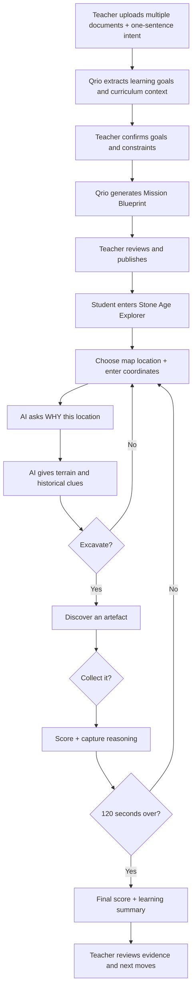

# Qrio Hackathon — Stone Age Explorer

**Integrated Learning Mission · Workflow, User Stories & Game Data Contract**  
Version: v0.2 · 2026-11-07  
Language: 繁體中文（技術與產品名稱保留英文）

> **Product Concept**：老師上傳多份教材並輸入一句教學意圖，Qrio 協助整理學習目標、生成 Integrated Learning Mission。學生扮演探險家，在 120 秒內利用座標探索不同地形、分析史前人類活動、挖掘並判斷文物。Qrio 保留過程中的選擇與理由，供老師確認學習證據並決定下一步。

## 1. Product Vision 與定位

**Turn what teachers have taught into meaningful missions where every learner can contribute, receive appropriate support, and demonstrate what they understand.**

本次 Hackathon 以情境 B（**Integrated Learning Mission**）為基礎，打造一套通用的學習任務工作流程，而 **Stone Age Explorer** 是用來驗證這套流程的互動式遊戲案例。

三個核心價值：

1. **Meaningful Challenge**：學生為了共同目標，自然地使用學過的知識。
2. **Adaptive Learning Support**：AI 以探險助手身份提問、提示，讓學生繼續思考與決策。
3. **Evidence-to-Action**：保留座標選擇、推理、提示、挖掘與採集決策，讓老師可從原始證據確認學生的理解並安排後續活動。

**共通產品架構：**

`Teacher Intent → Mission Contract → Interactive Runner → Learning Evidence → Teacher Decision`

> 設計邊界：兩分鐘的探索遊戲是跨科 Mission 的一個體驗或 Checkpoint。它能展示座標應用、地理推理與歷史判斷，但單次遊戲分數不足以單獨證明學生已掌握全部學習目標。

---

## 2. End-to-End Workflow



### Workflow by role

| 階段 | 老師／學生做什麼 | Qrio 做什麼 | 產出 |
|---|---|---|---|
| 1. Teacher Intent | 老師上傳多份教材、寫一句教學意圖 | 讀取文件與意圖 | Source Bundle |
| 2. Context Understanding | 老師查看初步理解 | 擷取概念、學習目標、限制與文件來源 | Teaching Context |
| 3. Intent Alignment | 老師確認或修正教學重點 | 提示跨科關係與待確認事項 | Confirmed Learning Goals |
| 4. Mission Design | 老師檢視建議的跨科任務 | 生成共同目標、學習路徑與 Checkpoint | Mission Blueprint / Contract |
| 5. Teacher Approval | 老師編輯並發布 | 生成教師與學生端任務 | Published Mission |
| 6. Mission Runner | 學生探索地圖、輸入座標、回答、挖掘、採集 | AI 探險助手提供對話與情境提示 | Student Decisions & Traces |
| 7. Checkpoint | 學生結束遊戲；教師查看紀錄 | 整理候選學習訊號與 next moves | Teacher-confirmed Evidence |
| 8. Follow-up | 老師安排補充、延伸或新一輪探索 | 連結前後作品與學習目標 | Follow-up Evidence |

### Teacher Input Example

**上傳文件（示例）**

- `五年級數學－座標.pdf`
- `社會－石器時代.pdf`
- `跨科素養評量規準.docx`

**一句教學意圖**

> 學生這週學過座標與石器時代，希望他們能在專題課中運用這些知識，共同完成一個有趣的挑戰。

**Qrio 應先確認的內容**

- 數學：使用座標定位與描述位置。
- 社會：依據歷史資料理解石器時代生活與工具。
- 教學設計：座標與史前生活知識都應是完成挑戰的必要條件。
- 年級、可用時數、教材的歷史範圍與評量方式：若文件未說明，標示「待教師確認」。
- 清楚區分「文件明確提供」、「AI 推論」、「教師已確認」。

---

## 3. Game Concept — Stone Age Explorer

**Player role**：探險家（Explorer）  
**AI role**：探險助手（Exploration Assistant）  
**Goal**：在限時內探索地形，發現可能屬於石器時代的文物，根據線索決定是否採集。  
**Game duration**：120 秒。  
**Map**：具有 X/Y 座標的方格地圖，包含河流、平原、沼澤、森林、高山五種地形。  
**Core learning**：座標定位、地形與人類活動關係、史前／其他時期文物的判斷。

### 3.1 每輪遊戲的七個動作

#### Step 1 — Explore：選擇探索位置

- 學生在地圖選擇探索點。
- 輸入對應座標，例如 `(3, 4)`。
- 系統驗證座標合法性，顯示對應地形。
- 紀錄：`coordinate_selected`。

#### Step 2 — Explain：AI 詢問選擇原因

- AI：「你選擇了河流附近。為什麼你認為這裡可能找到石器時代的文物？」
- 學生輸入簡短理由；MVP 可選擇提供簡化輸入方式。
- 系統保留回答，作為第一個重要 Learning Evidence。
- 紀錄：`reasoning_submitted`。

#### Step 3 — Contextual Hint：AI 提供地理與歷史線索

- AI 參照所選地形及教師教材提示人類活動的可能性，例如河流、水源、捕魚、狩獵採集、農耕聚落等。
- 範例：「河流能提供水源，也可能吸引人類與動物活動。狩獵採集社群和後來的農耕聚落，都可能選擇靠近水源的地方。」
- 提示協助推理，**避免直接透露該地點文物的年代與正確答案**。
- 紀錄：`hint_displayed`。

#### Step 4 — Decide：是否挖掘？

- AI：「你準備在這個位置挖掘嗎？」
- **Yes**：觸發該位置的發現事件。
- **No**：回到地圖繼續探索。
- 紀錄：`excavation_decision`。

#### Step 5 — Discover：發現物品

- 系統展示出土物品；它**可能屬於石器時代，也可能屬於其他時期**。
- 物品卡應提供可供判斷的線索，例如材質、製作方式、出土層位或對應歷史背景，避免完全依靠外觀猜測。
- 可使用：石製工具、陶器、金屬器物、近代硬幣等，前提是與教師設定的時間、地區與教材一致。
- 紀錄：`artefact_discovered`。

#### Step 6 — Collect：是否採集？

- 學生選擇 **Collect / Leave**。
- 可附上簡短理由，讓 Qrio 理解判斷依據。
- 系統根據已定義的文物資料與遊戲規則計分。
- 紀錄：`collection_decision`。

#### Step 7 — Score & Repeat：計分並繼續

- 顯示加減分、簡短回饋、更新後總分與剩餘時間。
- 若仍有時間，返回地圖探索下一個位置。
- 到達 120 秒時，停止操作並展示總分、發現紀錄及學習摘要。
- 紀錄：`score_updated`、`game_finished`。

### 3.2 文字版介面概念

```text
┌───────────────────────────────────────────────┐
│ STONE AGE EXPLORER                 01:24      │
│ Score: 20                                     │
├───────────────────────────────────────────────┤
│                                               │
│    [帶 X / Y 座標網格的探險地圖]               │
│    河流 / 平原 / 沼澤 / 森林 / 高山             │
│                                               │
├───────────────────────────────────────────────┤
│ Selected coordinates:  (3, 4)                │
│                                               │
│ AI Explorer Assistant:                        │
│ 為什麼你認為這裡有史前人類活動的痕跡？          │
│                                               │
│ [學生輸入理由...]                              │
│                                               │
│             [繼續探索]                        │
└───────────────────────────────────────────────┘
```

**下一狀態：** AI 給地形線索 →「決定挖掘嗎？」→ 發現文物 → Collect / Leave → 結算 → 繼續。

---

## 4. Scoring Rules（建議值，待 Hackathon 確認）

| 學生動作 | 分數 |
|---|---:|
| 正確採集石器時代物品 | +10 |
| 錯誤採集其他時期物品 | −5 |
| 正確選擇留下非石器時代物品 | +5 |
| 放棄採集石器時代物品 | 0 |
| 決定不挖掘 | 0 |
| 120 秒結束 | 結算總分 |

**設計理由**：除了獎勵正確發現，也獎勵能基於線索排除錯誤文物的判斷。

**計分與公平性要求**：

1. 地點、物品、年代標籤與得分應由事先設定的資料決定；AI 不應在遊戲進行時任意創造正確答案。
2. 若需要比較不同學生的遊戲成績，應使用一致的地圖、物品與計分規則，或清楚說明不同版本的差異。
3. 歷史範圍應以教師確認的教材為準。農耕活動不能一律視為非石器時代；新石器時代在部分地區涉及農耕與聚落發展。
4. 地形提示只能支持探索假設，年代判斷還需要參考文物及考古脈絡。
5. **遊戲得分 ≠ 學習能力的確定評分**；需結合學生選擇、理由與教師確認。

---

## 5. User Stories — Updated Hackathon Backlog

### Epic 1 — Teacher Intent to Mission

| ID | User Story | Acceptance Criteria | Priority |
|---|---|---|---|
| US-01 | As a teacher, I want to upload multiple teaching documents and describe my intent in one sentence, so Qrio can understand my teaching context without lengthy setup. | 支援多文件上傳；輸入一句話；有處理狀態與結果 | P0 |
| US-02 | As a teacher, I want to review Qrio's interpretation of my learning goals, so I can correct misunderstandings before designing a Mission. | 顯示概念與來源；可編輯目標；可補充資訊 | P0 |
| US-03 | As a teacher, I want Qrio to propose a meaningful challenge connecting my learning goals, so students can apply what they have learnt. | 產生 Mission Goal、Shared Outcome、學習目標、階段 | P0 |
| US-04 | As a teacher, I want to review and customise learning paths, so students can take different routes towards the same goal. | 2–3 條可調整路徑；核心學習目標一致 | P0 |
| US-05 | As a teacher, I want to approve and publish a Mission, so students can join it easily. | 可審核、編輯、發布，產生學生連結 | P0 |

### Epic 2 — Student Mission & Stone Age Explorer

| ID | User Story | Acceptance Criteria | Priority |
|---|---|---|---|
| US-06 | As a student, I want to understand our shared Mission and choose a learning path, so I know how I can contribute. | 可查看共同目標及路徑；可選擇 | P0 |
| US-06A | As a student, I want to play as an explorer on a terrain map, so I can choose where to search for Stone Age artefacts. | 五種地形；X/Y 座標；可選位置 | P0 |
| US-06B | As a student, I want to enter coordinates to select a location, so I can practise coordinate positioning. | 驗證座標；定位至對應格點 | P0 |
| US-07 | As a student, I want progressive hints when I get stuck, so I can continue thinking independently. | 提示分層；記錄求助；避免直接給答案 | P1 |
| US-07A | As a student, I want the AI assistant to ask why I chose a location, so I can explain my geographical and historical reasoning. | AI 提問；學生提交理由；保留回答 | P0 |
| US-07B | As a student, I want hints about terrain and human activity, so I can make better exploration decisions. | 提示與地形相關；知識適切；不洩漏答案 | P0 |
| US-07C | As a student, I want to decide whether to excavate, so my actions have consequences. | Yes 進入發現；No 返回地圖；保存決策 | P0 |
| US-08 | As a student, I want to submit an explanation or work at checkpoints, so my teacher can see my thinking. | 保存學生作品、任務與 Checkpoint 關聯 | P0 |
| US-08A | As a student, I want to discover artefacts from different historical periods, so I must evaluate evidence before collecting them. | 文物卡含線索；包含目標及非目標時期物品 | P0 |
| US-08B | As a student, I want to decide whether to collect an artefact, so I can test my historical understanding. | Collect / Leave；依預設資料計分 | P0 |
| US-08C | As a student, I want immediate score feedback, so I can understand my decision's result. | 加減分、簡短理由、總分更新 | P0 |
| US-08D | As a student, I want a two-minute timer and final score, so I can enjoy a focused exploration challenge. | 120 秒；到時停止；結果頁 | P0 |
| US-09 | As a student, I want to revise my work after feedback, so I can show what changed. | 版本保存；修正任務 | P1 |

### Epic 3 — Evidence to Next Move

| ID | User Story | Acceptance Criteria | Priority |
|---|---|---|---|
| US-10 | As a teacher, I want Qrio to highlight possible learning patterns, so I can decide where support is needed. | 原始作品、候選訊號、學習目標及依據 | P0 |
| US-10A | As a teacher, I want to review where students explored, why they chose locations, and which artefacts they collected, so I can understand reasoning beyond scores. | 座標、理由、提示、挖掘/採集決策與計分紀錄 | P1 |
| US-11 | As a teacher, I want to confirm or revise Qrio's interpretations, so instructional decisions remain under my control. | 可接受／修改／拒絕，保留確認狀態 | P0 |
| US-12 | As a teacher, I want to assign the next challenge based on evidence, so students can apply feedback. | 可選 Next Move；連到原作品 | P1 |
| US-13 | As a teacher, I want to compare original and follow-up work, so I can see changes and remaining support needs. | 前後作品與確認紀錄；不自動宣稱掌握能力 | P1 |

**Core Product User Story**

> As a teacher, I want Qrio to turn my teaching materials and intent into a meaningful learning mission that generates observable evidence of student understanding, so I can guide different learners towards the same learning goal and make informed next teaching decisions.

---

## 6. Learning Evidence Schema — 遊戲要留下什麼？

| Evidence | 學生實際行為 | 教師可用於觀察的內容 |
|---|---|---|
| Coordinate Evidence | 輸入 `(3,4)`，修正無效座標 | 座標定位與描述是否正確 |
| Geographical Reasoning | 解釋為什麼探索河流附近 | 能否合理連結地形、資源與人類活動 |
| Historical Understanding | 根據物品線索判斷是否採集 | 能否提出合理的時期判斷依據 |
| Decision-making | 選擇挖掘、放棄、採集或留下 | 是否以可觀察證據支持選擇 |
| Learning Support | 看過提示後改變策略 | 哪些提示可能對下一次嘗試有幫助 |

**兩層分工**：

- **Gameplay Scoring**：由結構化規則即時計分，降低延遲並維持公平性。
- **Learning Interpretation**：遊戲結束後整理候選理解訊號，附上原始行為與理由，交由教師確認。

建議保存每次事件的 `student_id`（或匿名測試代號）、`mission_id`、`timestamp`、`event_type`、`location_id`、`student_response`、`assistant_hint`、`score_delta`。對於教師判斷，另保留 `teacher_confirmation_status`。

---

## 7. Game Data Contract（Hackathon JSON Example）

下面資料是**示例資料，不是 production schema**。地點與文物應可由 Mission 設定，與模型自由生成的聊天文字分離。

```json
{
  "game_id": "stone_age_explorer",
  "mission_id": "mission_001",
  "duration_seconds": 120,
  "player_role": "Explorer",
  "ai_role": "Exploration Assistant",
  "map": {
    "grid_width": 5,
    "grid_height": 5,
    "terrain_types": [
      "river",
      "plain",
      "swamp",
      "forest",
      "mountain"
    ]
  },
  "locations": [
    {
      "id": "site_01",
      "coordinates": [3, 4],
      "terrain": "river",
      "reasoning_question": "Why explore near the river?",
      "context_hint": "Water sources may attract animals and human settlements.",
      "artefact_id": "artefact_01"
    }
  ],
  "artefacts": [
    {
      "id": "artefact_01",
      "name": "Flaked Stone Tool",
      "is_target_period": true,
      "evidence_clue": "A worked stone edge with associated stone flakes.",
      "source_reference": "teacher_material_01"
    }
  ],
  "scoring": {
    "correct_collect": 10,
    "incorrect_collect": -5,
    "correct_leave": 5,
    "missed_target": 0
  },
  "evidence_events": [
    "coordinate_selected",
    "reasoning_submitted",
    "hint_displayed",
    "excavation_decision",
    "artefact_discovered",
    "collection_decision",
    "score_updated"
  ]
}
```

**建議 Developer 保留的分離設計**

- **Mission Contract**：定義教學意圖、學習目標、共同挑戰、路徑與 Checkpoint。
- **Game Scenario**：定義地圖、座標、地形、出土物品、歷史線索與分數。
- **Game Events**：記錄學生過程中的行為與回應。
- **Evidence Interpretation**：依教師已確認的學習目標，整理可供教師審核的訊號。

---

## 8. Hackathon Implementation Priority

| Priority | Feature | 驗收重點 |
|---|---|---|
| P0 | Teacher Input | 多文件上傳＋一句話 |
| P0 | Teaching Context Extraction | 概念、學習目標、教材來源、教師確認 |
| P0 | Mission Generation | 生成探險主題、學習目標、地圖／遊戲設定 |
| P0 | 5×5 Coordinate Map | 五種地形、X/Y 座標、位置選擇 |
| P0 | AI Exploration Assistant | Why question、地形提示、挖掘確認 |
| P0 | Discovery & Collect | 文物發現、時期線索、採集選擇、計分 |
| P0 | 120-second Game | 倒數、可重複探索、結果結算 |
| P1 | Evidence Studio | 教師查看座標、理由、求助、決策及可能理解訊號 |
| P1 | Follow-up Mission | 根據教師確認結果建立下一個學習挑戰 |

**Hackathon 建議範圍**

1. 準備 **8–12 組事先設計好的探索地點與文物**，涵蓋目標時期與其他時期。
2. 讓 AI 主要負責與教材對齊的提問及提示；分數、文物類型與結果由結構化資料控制。
3. 第一個可執行 Demo 先把一輪完整遊戲串通，再增加地圖位置及結算。
4. 教師端 Evidence Studio 可先以少量模擬學生紀錄展示，但必須標示為 Demo Data。
5. 將遊戲當成一種 Runner Template，以第二組教材測試流程通用性。

---

## 9. Demo Narrative（示例）

| Demo Step | 展示畫面 | 要證明的價值 |
|---|---|---|
| 1 | 老師上傳座標與石器時代教材，寫下一句教學意圖 | 降低設計任務的起始門檻 |
| 2 | Qrio 整理教學目標與來源，老師確認 | 對齊教材與教學意圖 |
| 3 | Qrio 產生 Stone Age Explorer Mission | 跨科知識進入共同挑戰 |
| 4 | 學生在五種地形上輸入座標，解釋探索原因 | 看見數學應用與地理推理 |
| 5 | AI 提供情境提示，學生選擇挖掘、判斷採集 | 促進自主判斷與歷史應用 |
| 6 | 120 秒結束，顯示得分與探索紀錄 | 即時互動回饋 |
| 7 | 教師查看學生理由及候選理解訊號 | Learning Evidence → Next Move |

### Demo Success Criteria

- 不依賴特定教材檔名，能從多份文件加一句話啟動 Mission。
- 擷取內容保留文件依據；AI 的推測需由教師確認。
- 兩個學科的知識對遊戲決策具有實際用途。
- 學生可以從座標 → Why → Hint → Excavate → Discover → Collect → Score 走完至少一輪。
- 120 秒後能正常結算。
- 至少保留座標、理由、提示與採集決策，以供老師審閱。
- 不以單次遊戲分數直接判定學生是否掌握學科能力。

## 10. One-sentence Developer Brief

> **We're building a document-grounded Mission Builder that turns a teacher's one-sentence intent into a shared learning challenge. Our first Runner is a 120-second Stone Age exploration game where learners use coordinates, explain decisions, receive contextual AI hints, evaluate artefacts, and leave evidence teachers can use to choose the next move.**

---

*本文保留了前述 Workflow／User Story 設計，並將遊戲設定、計分規則與資料契約整理為 Hackathon 開發參考。計分數值、5×5 地圖、8–12 個地點屬於建議實作設定，應由團隊確認。*
